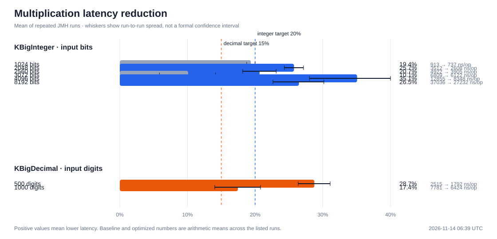
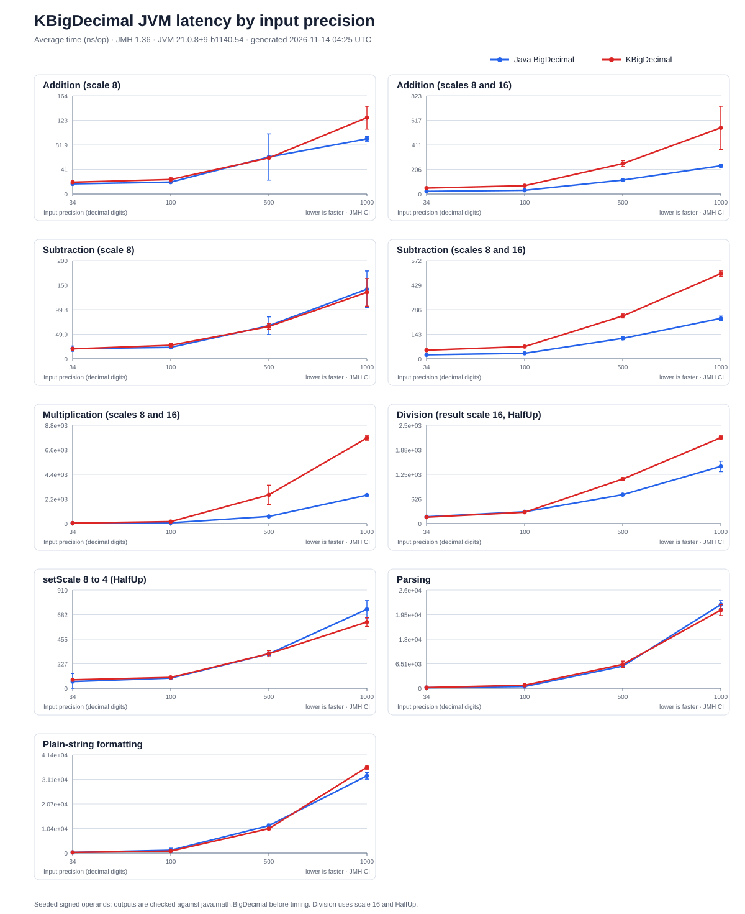
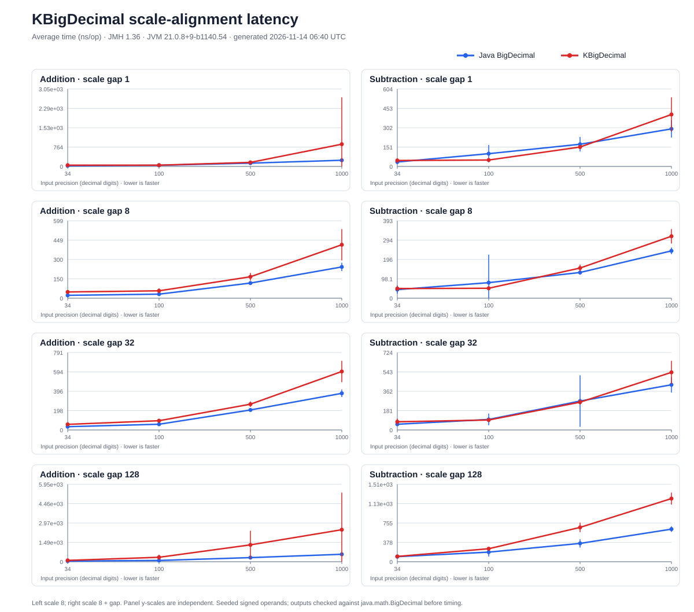

# KBigNum

[](https://kotlinlang.org/docs/multiplatform.html)
[](https://central.sonatype.com/artifact/io.github.gatrongdev/kbignum)
[](LICENSE)
[](https://github.com/gatrongdev/kbignum/actions)
[](https://codecov.io/gh/gatrongdev/kbignum)

A **Kotlin Multiplatform** library for arbitrary precision mathematics, providing unified APIs for high-precision arithmetic operations across Android, JVM, and iOS.

## Features

- **Arbitrary Precision Arithmetic**: Handle numbers with unlimited precision using `KBigDecimal` and `KBigInteger`.
- **Mathematical Mathematical**: `gcd`, `lcm`, `factorial`, `sqrt`, `pow`.
- **Bitwise Operations**: `and`, `or`, `xor`, `not`, `andNot` (with full 2's complement behavior).
- **Pure Kotlin Implementation**: No JNI or native dependencies required, ensuring maximum compatibility.
- **Multiplatform Support**: Single codebase works seamlessly on **Android**, **iOS**, **JVM**, **JS**, and **Native**.
- **Type-Safe API**: Strongly typed interfaces mimicking Java's `BigDecimal`/`BigInteger`.
- **Natural Syntax**: Operator overloading (`+`, `-`, `*`, `/`) for intuitive mathematical expressions.

See the [architecture and testing guide](docs/architecture.md) for the module layout, test placement, and enforced coverage floors.

## Installation

### Gradle (Kotlin DSL)

Add to your `build.gradle.kts`:

```kotlin
dependencies {
    implementation("io.github.gatrongdev:kbignum:VERSION")
}
```

### Gradle (Groovy)

Add to your `build.gradle`:

```gradle
dependencies {
    implementation 'io.github.gatrongdev:kbignum:VERSION'
}
```

## Performance
The previous hand-timed figures were removed because their one-shot millisecond measurements and operand generation were not reproducible. This JVM baseline uses JMH to compare `KBigInteger` with `java.math.BigInteger` using the same seeded operands. Each result is checked for equality before timing.

The chart shows average latency in nanoseconds per operation across 1024-, 2048-, 2560-, 3072-, 4096-, and 8192-bit operands. Division and remainder use a 2:1 dividend-to-divisor bit-length ratio so the quotient is nontrivial. JMH runs one thread, three forks, two warmup iterations, and four measurement iterations of 250 ms each. Ratio markers distinguish separated confidence intervals from inconclusive overlaps.


The multiplication crossover chart compares the production multiplication path with a forced schoolbook reference around its measured dispatch points. It sweeps balanced operands and 2:1 and 4:1 size ratios; raw measurements are in [`benchmarks/results/multiplication-crossover.csv`](benchmarks/results/multiplication-crossover.csv).


<!-- MULTIPLICATION_OPTIMIZATION_START -->

### Multiplication optimization A/B profile

The chart compares repeated baseline and optimized JMH runs on the same JVM and machine. Bars show mean latency reduction; whiskers combine the observed run-to-run ranges and are not formal confidence intervals.



| Workload | Baseline mean | Optimized mean | Latency reduction |
| :--- | ---: | ---: | ---: |
| KBigInteger multiply · 1024 bits | 913 ns/op | 737 ns/op | 19.4% |
| KBigInteger multiply · 2048 bits | 3512 ns/op | 2608 ns/op | 25.7% |
| KBigInteger multiply · 2560 bits | 4922 ns/op | 3905 ns/op | 20.7% |
| KBigInteger multiply · 3072 bits | 6809 ns/op | 6122 ns/op | 10.1% |
| KBigInteger multiply · 4096 bits | 12855 ns/op | 8348 ns/op | 35.1% |
| KBigInteger multiply · 8192 bits | 37036 ns/op | 27232 ns/op | 26.5% |
| KBigDecimal multiply · 500 digits | 2515 ns/op | 1792 ns/op | 28.7% |
| KBigDecimal multiply · 1000 digits | 7781 ns/op | 6424 ns/op | 17.4% |

The measured target was reached at 4/6 KBigInteger sizes (at least 20% reduction) and 2/2 KBigDecimal sizes (at least 15% reduction). The aggregated comparison and environment details are in [`multiplication-optimization.csv`](benchmarks/results/multiplication-optimization.csv).

<!-- MULTIPLICATION_OPTIMIZATION_END -->

The BigDecimal chart compares `KBigDecimal` with `java.math.BigDecimal` at 34, 100, 500, and 1000 input digits. It covers same-scale and mismatched-scale addition and subtraction, multiplication, division at scale 16 with `HalfUp`, rescaling from 8 to 4 with `HalfUp`, parsing, and plain-string formatting. Inputs are seeded and signed; each corresponding result is checked before timing. Parsing and formatting are measured separately from arithmetic. The scale-alignment sweep reuses 32 seeded operand pairs and measures addition and subtraction with scale gaps of 1, 8, 32, and 128.





<!-- BENCHMARK_SUMMARY_START -->

### KBigInteger latency ratio

Each cell is `KBigInteger ns/op ÷ Java BigInteger ns/op`. `↓`/`↑` mark non-overlapping JMH intervals; `†` marks overlapping intervals, so the ratio is inconclusive.

Interval overlap is a conservative visual cue, not a formal paired significance test.

| Operation (KBigInteger / Java BigInteger) | 1024 bits | 2048 bits | 2560 bits | 3072 bits | 4096 bits | 8192 bits |
| :--- | :---: | :---: | :---: | :---: | :---: | :---: |
| Addition | 0.76x† | **↓ 0.68x** | 0.62x† | **↓ 0.67x** | 0.79x† | 0.66x† |
| Subtraction | 1.09x† | **↑ 1.17x** | **↑ 1.14x** | **↑ 1.18x** | 1.12x† | **↑ 1.16x** |
| Multiplication | 4.66x† | **↑ 2.75x** | **↑ 2.01x** | **↑ 2.40x** | 2.58x† | 1.34x† |
| Division | 1.02x† | 0.95x† | 0.97x† | 0.34x† | 0.95x† | **↑ 1.58x** |
| Remainder | 0.96x† | 1.05x† | 1.00x† | 0.98x† | **↓ 0.98x** | **↑ 1.62x** |

Full operation comparison generated 2026-11-14 06:40 UTC on Darwin 25.2.0 / arm64 with JMH 1.36 and JVM 21.0.8+9-b1140.54. Data: [`latest.csv`](benchmarks/results/latest.csv).

### Current multiplication crossover check

A crossover is reported only when the production confidence interval is below the schoolbook interval at three consecutive tested sizes; isolated wins are treated as noise.

| Operand ratio (larger : smaller) | First size with a stable win |
| :---: | :--- |
| 1:1 | No stable win in tested range |
| 2:1 | No stable win in tested range |
| 4:1 | No stable win in tested range |

Crossover comparison generated 2026-11-14 06:40 UTC on Darwin 25.2.0 / arm64 with JMH 1.36 and JVM 21.0.8+9-b1140.54. Data: [`multiplication-crossover.csv`](benchmarks/results/multiplication-crossover.csv).

<!-- BENCHMARK_SUMMARY_END -->

<!-- BIGDECIMAL_BENCHMARK_SUMMARY_START -->

### KBigDecimal latency ratio

Each cell is `KBigDecimal ns/op ÷ Java BigDecimal ns/op`. `↓`/`↑` mark non-overlapping JMH intervals; `†` marks overlapping intervals, so the ratio is inconclusive.

Interval overlap is a conservative visual cue, not a formal paired significance test.

| Operation (KBigDecimal / Java BigDecimal) | 34 digits | 100 digits | 500 digits | 1000 digits |
| :--- | :---: | :---: | :---: | :---: |
| Addition (scale 8) | 1.11x† | 1.09x† | **↑ 1.20x** | **↑ 1.30x** |
| Addition (scales 8 and 16) | 1.62x† | **↑ 1.65x** | 1.46x† | **↑ 1.22x** |
| Subtraction (scale 8) | 1.05x† | 1.44x† | 1.21x† | **↑ 1.26x** |
| Subtraction (scales 8 and 16) | **↑ 1.48x** | **↑ 1.84x** | **↑ 1.23x** | **↑ 1.18x** |
| Multiplication (scales 8 and 16) | **↑ 1.52x** | **↑ 2.40x** | **↑ 2.76x** | **↑ 2.42x** |
| Division (result scale 16, HalfUp) | 0.93x† | **↓ 0.85x** | **↑ 1.37x** | **↑ 1.46x** |
| setScale 8 to 4 (HalfUp) | **↑ 1.63x** | 1.13x† | **↑ 1.13x** | 0.97x† |
| Parsing | 1.21x† | 1.73x† | **↓ 0.85x** | **↓ 0.70x** |
| Plain-string formatting | 0.96x† | 0.87x† | 0.91x† | 1.29x† |

Across every tested input size in this run, KBigDecimal had separated slower intervals for Subtraction (scales 8 and 16), Multiplication (scales 8 and 16). Treat these as profiling candidates for the recorded JVM and machine.

Generated 2026-11-14 06:40 UTC on Darwin 25.2.0 / arm64 with JMH 1.36 and JVM 21.0.8+9-b1140.54. Data: [`latest-bigdecimal.csv`](benchmarks/results/latest-bigdecimal.csv).

### Scale-alignment latency ratio

Addition and subtraction align a left operand at scale 8 with a right operand at scale `8 + gap`. Each cell is `KBigDecimal ns/op ÷ Java BigDecimal ns/op`; lower is faster. `↓`/`↑` mark non-overlapping JMH intervals and `†` marks overlap.

| Operation / scale gap | 34 digits | 100 digits | 500 digits | 1000 digits |
| :--- | :---: | :---: | :---: | :---: |
| Addition, gap 1 | **↑ 1.94x** | 1.11x† | **↑ 1.22x** | 3.61x† |
| Addition, gap 8 | **↑ 2.15x** | **↑ 1.83x** | **↑ 1.42x** | **↑ 1.71x** |
| Addition, gap 32 | **↑ 1.71x** | **↑ 1.61x** | **↑ 1.29x** | **↑ 1.60x** |
| Addition, gap 128 | **↑ 2.00x** | **↑ 3.51x** | 4.10x† | 4.31x† |
| Subtraction, gap 1 | 1.33x† | 0.50x† | 0.88x† | 1.38x† |
| Subtraction, gap 8 | 1.11x† | 0.64x† | 1.17x† | **↑ 1.31x** |
| Subtraction, gap 32 | 1.44x† | 0.94x† | 0.96x† | 1.27x† |
| Subtraction, gap 128 | 1.05x† | 1.36x† | **↑ 1.88x** | **↑ 1.94x** |

The chart and raw measurements are available in [`benchmark-decimal-scale-alignment.svg`](docs/assets/benchmark-decimal-scale-alignment.svg) and [`scale-alignment.csv`](benchmarks/results/scale-alignment.csv).

<!-- BIGDECIMAL_BENCHMARK_SUMMARY_END -->

### Regenerate the benchmark

Run `./gradlew updateBenchmark` with JDK 17 or newer and Python 3.8 or newer. This runs the integer, decimal, and multiplication crossover JMH suites, saves the measurements to CSV, updates all charts, and refreshes the ratio tables above.

The chart is a JVM snapshot for the recorded machine and JDK. It does not predict Android, iOS, JS, or Native performance and is not used as a CI pass/fail threshold.

## BigDecimal scale and rounding

`KBigDecimal` stores a value as `unscaledValue × 10^-scale`. Scale is part of representation: `1.0` and `1.00` compare numerically as equal, but `equals` returns false because their scales differ. Trailing zeros are preserved by parsing and formatting.

Division has explicit scale behavior. The `/` operator returns 10 fractional digits with `HalfUp`; `divide(other)` returns `max(this.scale, other.scale)` fractional digits with `HalfUp`; use the overload with `scale` and `rounding` when a calculation needs a specific result scale.

```kotlin
val amount = "1.00".toKBigDecimal()
val divisor = "3.0".toKBigDecimal()

val operatorResult = amount / divisor // scale 10, HalfUp
val defaultResult = amount.divide(divisor) // max input scale (2), HalfUp
val explicitResult = amount.divide(divisor, scale = 6, rounding = KBRoundingMode.HalfEven)
```


## Quick Start

### Basic Usage

```kotlin
import io.github.gatrongdev.kbignum.math.*

// Creating big numbers
val bigDecimal1 = "123.456789".toKBigDecimal()
val bigDecimal2 = KBigDecimal.fromString("987.654321")
val bigInteger = "12345678901234567890".toKBigInteger()

// Basic arithmetic
val sum = bigDecimal1 + bigDecimal2
val difference = bigDecimal1 - bigDecimal2
val product = bigDecimal1 * bigDecimal2

// Division (Operator '/' defaults to scale 10, HALF_UP)
val quotient = bigDecimal1 / bigDecimal2

// Precise Division
val preciseQuotient = bigDecimal1.divide(bigDecimal2, scale = 20, rounding = KBRoundingMode.HalfUp)

// Advanced operations
val sqrt = KBigMath.sqrt(bigDecimal1, 10)
val factorial = KBigMath.factorial(bigInteger)
val isPrime = KBigMath.isPrime(bigInteger)
```

### Extension Functions

```kotlin
// Convert from various types
val fromString = "999.999".toKBigDecimal()
val fromInt = 42.toKBigInteger()
val fromLong = 1234567890L.toKBigDecimal()

// Utility functions
val isZero = bigDecimal1.isZero()
val isPositive = bigDecimal1.isPositive()
val absolute = bigDecimal1.abs()
val sign = bigDecimal1.signum()
```

### Advanced Mathematics

```kotlin
// Mathematical operations
val bigInteger1 = "48".toKBigInteger()
val bigInteger2 = "18".toKBigInteger()
val bigDecimal1 = "12.5".toKBigDecimal()

val gcd = KBigMath.gcd(bigInteger1, bigInteger2)
val lcm = KBigMath.lcm(bigInteger1, bigInteger2)
val power = bigDecimal1.pow(5)
```

## Platform Support

### Android
- **Minimum API Level**: 21
- **Implementation**: Pure Kotlin (Single Codebase). No JNI involved.
- **Output**: AAR library files

#### Android SDK configuration
- SDK levels are centralized in the root `gradle.properties` (`android.compileSdk`, `android.minSdk`, `android.targetSdk`).
- Override them per build by supplying Gradle properties, e.g.:
    ```bash
    ./gradlew :shared:assembleRelease -Pandroid.compileSdk=34 -Pandroid.targetSdk=34
    ```
- Module builds automatically pick up the configured values; no manual edits inside `shared/build.gradle.kts` are required.

### iOS
- **Minimum Version**: 13.0
- **Implementation**: Pure Kotlin (Single Codebase). No `NSDecimalNumber` bridging overhead.
- **Output**: XCFramework with arm64 and x64 support

## Requirements

- **Kotlin**: 1.9.10+
- **Gradle**: 8.11.1+
- **Android**: API level 21+
- **iOS**: 13.0+

## License

This project is licensed under the Apache License, Version 2.0 - see the [LICENSE](LICENSE) file for details.

## Author

**Gatrong Dev** - [GitHub](https://github.com/gatrongdev)
