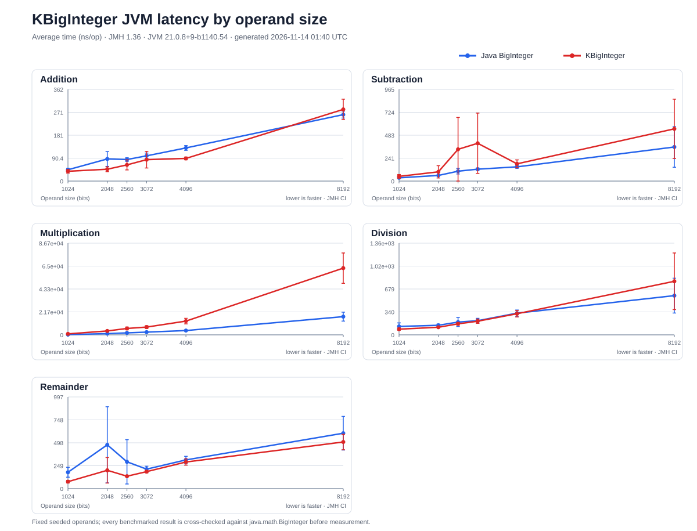
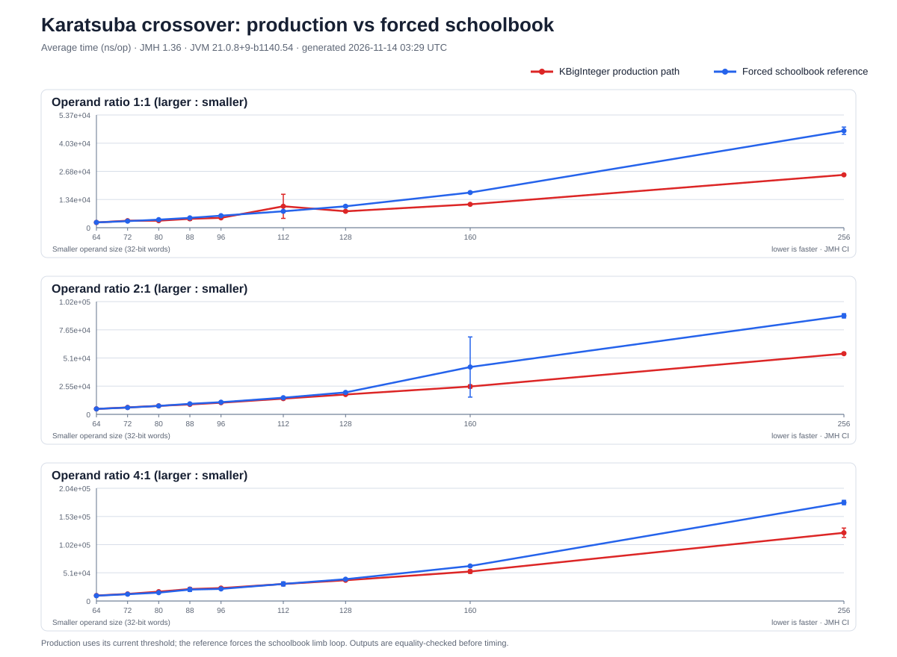

# KBigNum

[](https://kotlinlang.org/docs/multiplatform.html)
[](https://central.sonatype.com/artifact/io.github.gatrongdev/kbignum)
[](LICENSE)
[](https://github.com/gatrongdev/kbignum/actions)
[](https://codecov.io/gh/gatrongdev/kbignum)

A **Kotlin Multiplatform** library for arbitrary precision mathematics, providing unified APIs for high-precision arithmetic operations across Android, iOS, and Web platforms.

## Features

- **Arbitrary Precision Arithmetic**: Handle numbers with unlimited precision using `KBigDecimal` and `KBigInteger`.
- **Mathematical Mathematical**: `gcd`, `lcm`, `factorial`, `sqrt`, `pow`.
- **Bitwise Operations**: `and`, `or`, `xor`, `not`, `andNot` (with full 2's complement behavior).
- **Pure Kotlin Implementation**: No JNI or native dependencies required, ensuring maximum compatibility.
- **Multiplatform Support**: Single codebase works seamlessly on **Android**, **iOS**, **JVM**, **JS**, and **Native**.
- **Type-Safe API**: Strongly typed interfaces mimicking Java's `BigDecimal`/`BigInteger`.
- **Natural Syntax**: Operator overloading (`+`, `-`, `*`, `/`) for intuitive mathematical expressions.

## Installation

### Gradle (Kotlin DSL)

Add to your `build.gradle.kts`:

```kotlin
dependencies {
    implementation("io.github.gatrongdev:kbignum:VERSION")
}
```

### Gradle (Groovy)

Add to your `build.gradle`:

```gradle
dependencies {
    implementation 'io.github.gatrongdev:kbignum:VERSION'
}
```

## Performance
The previous hand-timed figures were removed because their one-shot millisecond measurements and operand generation were not reproducible. This JVM baseline uses JMH to compare `KBigInteger` with `java.math.BigInteger` using the same seeded operands. Each result is checked for equality before timing.

The chart shows average latency in nanoseconds per operation across 1024-, 2048-, 2560-, 3072-, 4096-, and 8192-bit operands. Division and remainder use a 2:1 dividend-to-divisor bit-length ratio so the quotient is nontrivial. JMH runs one thread, three forks, two warmup iterations, and four measurement iterations of 250 ms each. Ratio markers distinguish separated confidence intervals from inconclusive overlaps.



The multiplication crossover chart compares the production multiplication path with a forced schoolbook reference around its measured dispatch points. It sweeps balanced operands and 2:1 and 4:1 size ratios; raw measurements are in [`benchmarks/results/multiplication-crossover.csv`](benchmarks/results/multiplication-crossover.csv).



<!-- BENCHMARK_SUMMARY_START -->

### KBigInteger latency ratio

Each cell is `KBigInteger ns/op ÷ Java BigInteger ns/op`. `↓`/`↑` mark non-overlapping JMH intervals; `†` marks overlapping intervals, so the ratio is inconclusive.

Interval overlap is a conservative visual cue, not a formal paired significance test.

| Operation (KBigInteger / Java BigInteger) | 1024 bits | 2048 bits | 2560 bits | 3072 bits | 4096 bits | 8192 bits |
| :--- | :---: | :---: | :---: | :---: | :---: | :---: |
| Addition | **↓ 0.68x** | **↓ 0.65x** | **↓ 0.64x** | **↓ 0.63x** | 0.55x† | **↓ 0.70x** |
| Subtraction | 1.37x† | 1.46x† | 2.02x† | 1.42x† | 1.33x† | 1.06x† |
| Multiplication | **↑ 3.68x** | 5.34x† | **↑ 2.69x** | **↑ 3.14x** | **↑ 3.07x** | **↑ 2.38x** |
| Division | 1.28x† | 1.28x† | **↑ 2.00x** | 1.31x† | 0.93x† | 0.98x† |
| Remainder | 0.97x† | 1.12x† | 1.23x† | 0.97x† | 1.02x† | 1.38x† |

### Current multiplication crossover check

| Operand ratio (larger : smaller) | First size where production CI is below schoolbook CI |
| :---: | :--- |
| 1:1 | 88 words |
| 2:1 | 96 words |
| 4:1 | 160 words |

Generated 2026-11-14 02:34 UTC on Darwin 25.2.0 / arm64 with JMH 1.36 and JVM 21.0.8+9-b1140.54. Data: [`latest.csv`](benchmarks/results/latest.csv) and [`multiplication-crossover.csv`](benchmarks/results/multiplication-crossover.csv).

<!-- BENCHMARK_SUMMARY_END -->

### Regenerate the benchmark

Run `./gradlew updateBenchmark` with JDK 17 or newer and Python 3.8 or newer. This runs the JMH suite, saves the arithmetic and crossover measurements to CSV, updates both charts, and refreshes the ratio table above.

The chart is a JVM snapshot for the recorded machine and JDK. It does not predict Android, iOS, JS, or Native performance and is not used as a CI pass/fail threshold.


## Quick Start

### Basic Usage

```kotlin
import io.github.gatrongdev.kbignum.math.*

// Creating big numbers
val bigDecimal1 = "123.456789".toKBigDecimal()
val bigDecimal2 = KBigDecimal.fromString("987.654321")
val bigInteger = "12345678901234567890".toKBigInteger()

// Basic arithmetic
val sum = bigDecimal1 + bigDecimal2
val difference = bigDecimal1 - bigDecimal2
val product = bigDecimal1 * bigDecimal2

// Division (Operator '/' defaults to scale 10, HALF_UP)
val quotient = bigDecimal1 / bigDecimal2

// Precise Division
val preciseQuotient = bigDecimal1.divide(bigDecimal2, scale = 20, rounding = KBRoundingMode.HalfUp)

// Advanced operations
val sqrt = KBigMath.sqrt(bigDecimal1, 10)
val factorial = KBigMath.factorial(bigInteger)
val isPrime = KBigMath.isPrime(bigInteger)
```

### Extension Functions

```kotlin
// Convert from various types
val fromString = "999.999".toKBigDecimal()
val fromInt = 42.toKBigInteger()
val fromLong = 1234567890L.toKBigDecimal()

// Utility functions
val isZero = bigDecimal1.isZero()
val isPositive = bigDecimal1.isPositive()
val absolute = bigDecimal1.abs()
val sign = bigDecimal1.signum()
```

### Advanced Mathematics

```kotlin
// Mathematical operations
val bigInteger1 = "48".toKBigInteger()
val bigInteger2 = "18".toKBigInteger()
val bigDecimal1 = "12.5".toKBigDecimal()

val gcd = KBigMath.gcd(bigInteger1, bigInteger2)
val lcm = KBigMath.lcm(bigInteger1, bigInteger2)
val power = bigDecimal1.pow(5)
```

## Platform Support

### Android
- **Minimum API Level**: 21
- **Implementation**: Pure Kotlin (Single Codebase). No JNI involved.
- **Output**: AAR library files

#### Android SDK configuration
- SDK levels are centralized in the root `gradle.properties` (`android.compileSdk`, `android.minSdk`, `android.targetSdk`).
- Override them per build by supplying Gradle properties, e.g.:
    ```bash
    ./gradlew :shared:assembleRelease -Pandroid.compileSdk=34 -Pandroid.targetSdk=34
    ```
- Module builds automatically pick up the configured values; no manual edits inside `shared/build.gradle.kts` are required.

### iOS
- **Minimum Version**: 13.0
- **Implementation**: Pure Kotlin (Single Codebase). No `NSDecimalNumber` bridging overhead.
- **Output**: XCFramework with arm64 and x64 support

## Requirements

- **Kotlin**: 1.9.10+
- **Gradle**: 8.11.1+
- **Android**: API level 21+
- **iOS**: 13.0+

## License

This project is licensed under the Apache License, Version 2.0 - see the [LICENSE](LICENSE) file for details.

## Author

**Gatrong Dev** - [GitHub](https://github.com/gatrongdev)
