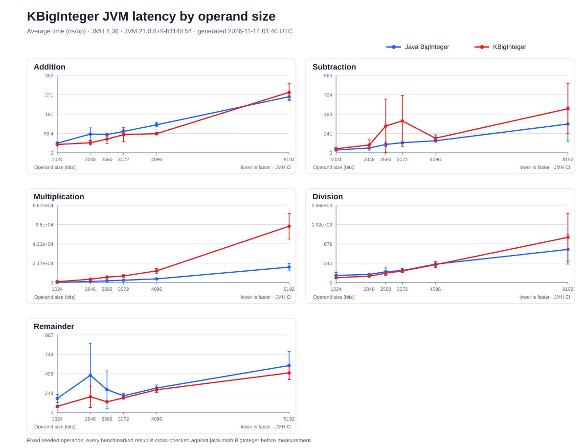
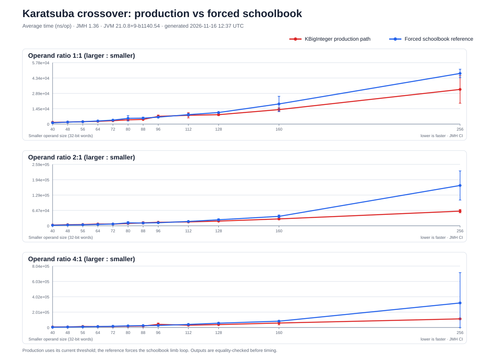
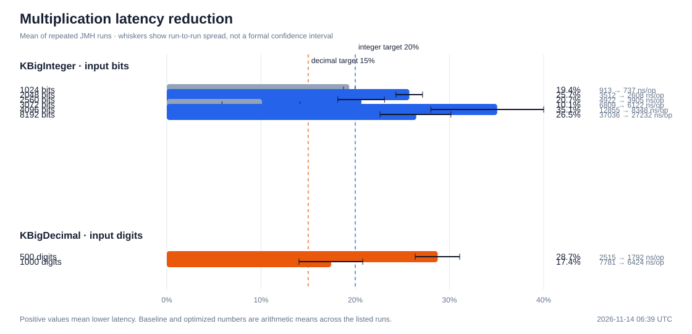
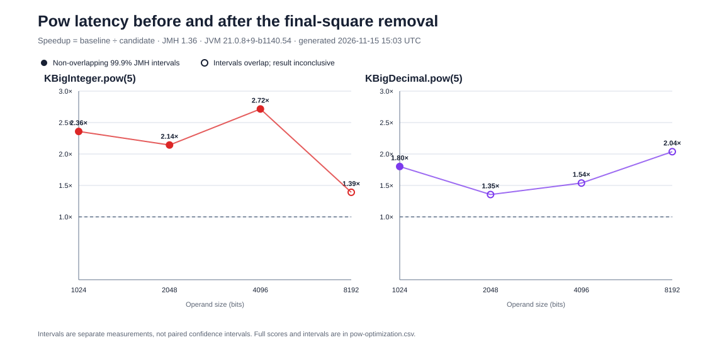
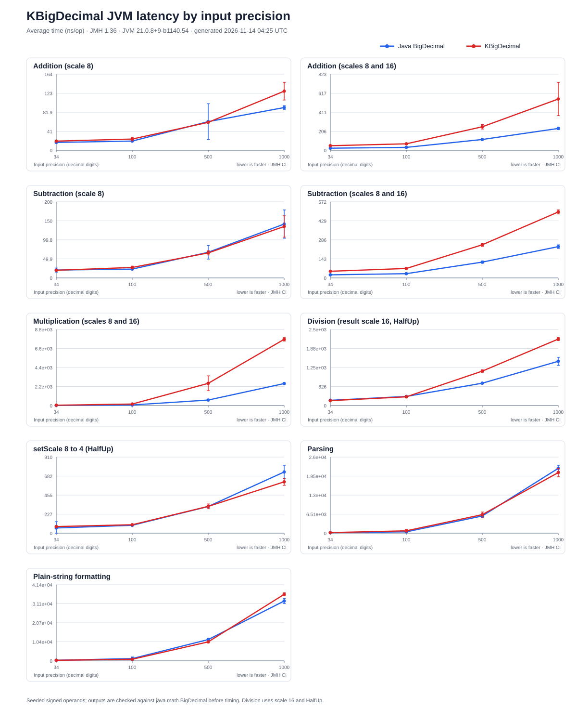
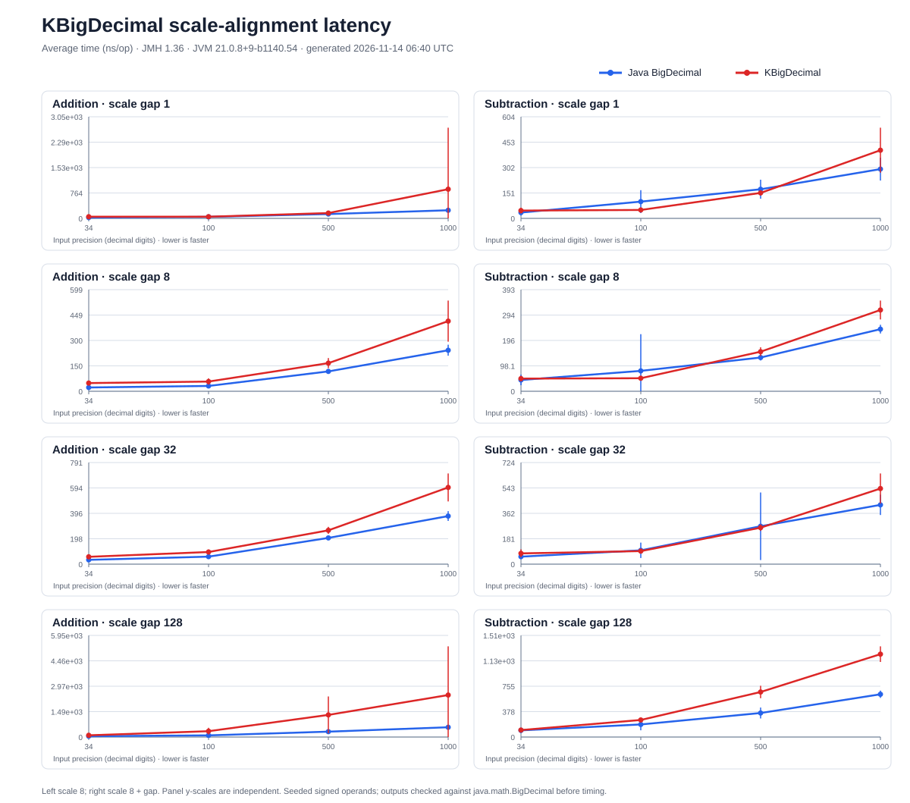
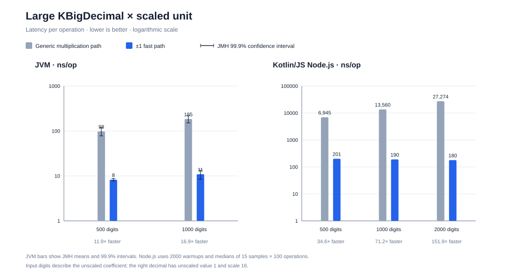
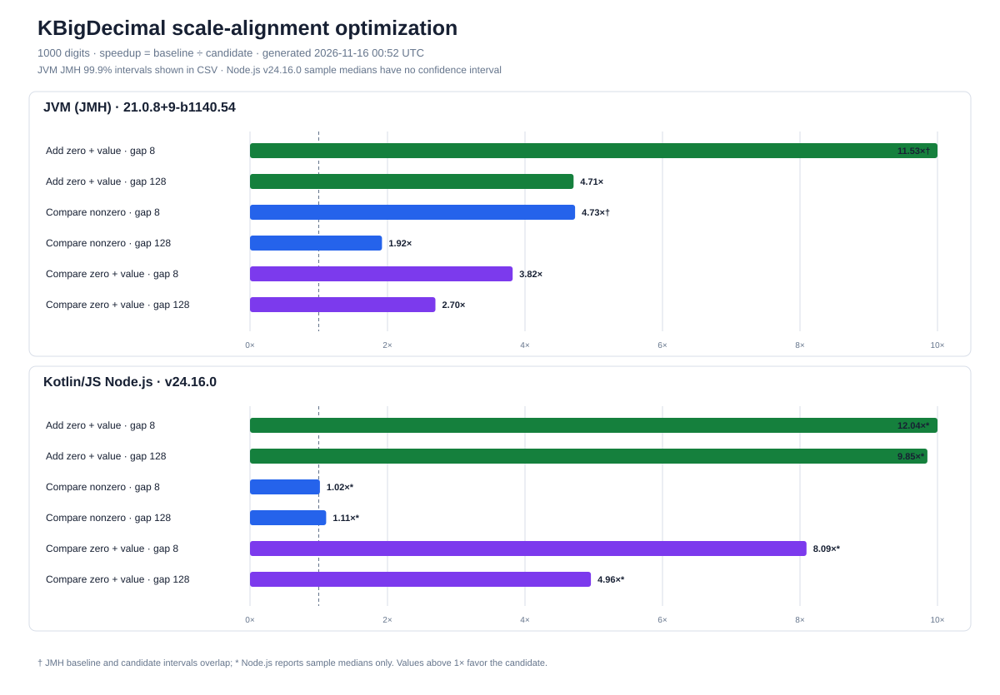

# KBigNum

[](https://kotlinlang.org/docs/multiplatform.html)
[](https://central.sonatype.com/artifact/io.github.gatrongdev/kbignum)
[](LICENSE)
[](https://github.com/gatrongdev/kbignum/actions)
[](https://codecov.io/gh/gatrongdev/kbignum)

A **Kotlin Multiplatform** library for arbitrary precision mathematics, providing unified APIs for high-precision arithmetic operations across Android, JVM, iOS, and Kotlin/JS on Node.js and in browsers.

## Features

- **Arbitrary Precision Arithmetic**: Handle numbers with unlimited precision using `KBigDecimal` and `KBigInteger`.
- **Mathematical Mathematical**: `gcd`, `lcm`, `factorial`, `sqrt`, `pow`.
- **Bitwise Operations**: `and`, `or`, `xor`, `not`, `andNot` (with full 2's complement behavior).
- **Pure Kotlin Implementation**: No JNI or native dependencies required, ensuring maximum compatibility.
- **Multiplatform Support**: Single codebase targets **Android**, **iOS**, **JVM**, and **Kotlin/JS on Node.js and in browsers**.
- **Type-Safe API**: Strongly typed interfaces mimicking Java's `BigDecimal`/`BigInteger`.
- **Natural Syntax**: Operator overloading (`+`, `-`, `*`, `/`) for intuitive mathematical expressions.

See the [architecture and testing guide](docs/architecture.md) for the module layout, test placement, and enforced coverage floors.

## Installation

### Gradle (Kotlin DSL)

Add to your `build.gradle.kts`:

```kotlin
dependencies {
    implementation("io.github.gatrongdev:kbignum:VERSION")
}
```

### Gradle (Groovy)

Add to your `build.gradle`:

```gradle
dependencies {
    implementation 'io.github.gatrongdev:kbignum:VERSION'
}
```

## Performance
The previous hand-timed figures were removed because their one-shot millisecond measurements and operand generation were not reproducible. This JVM baseline uses JMH to compare `KBigInteger` with `java.math.BigInteger` using the same seeded operands. Each result is checked for equality before timing.

The chart shows average latency in nanoseconds per operation across 1024-, 2048-, 2560-, 3072-, 4096-, and 8192-bit operands. Division and remainder use a 2:1 dividend-to-divisor bit-length ratio so the quotient is nontrivial. JMH runs one thread, three forks, two warmup iterations, and four measurement iterations of 250 ms each. Ratio markers distinguish separated confidence intervals from inconclusive overlaps.



The multiplication crossover chart compares the production multiplication path with a forced schoolbook reference around the dispatch boundaries. It sweeps 40, 48, and 56 words as well as larger balanced, 2:1, and 4:1 operands; raw measurements are in [`benchmarks/results/multiplication-crossover.csv`](benchmarks/results/multiplication-crossover.csv).



### Karatsuba threshold calibration

The common implementation keeps a 40-word top-level cutoff and a 48-word recursive cutoff. A temporary top-level candidate of 48 words improved JVM `KBigDecimal.multiply` at 400 digits in two JMH runs (1.35× and 1.37×) and at 450 digits in one run (1.11×); the second 450-digit run was inconclusive. On Node.js, three A/B pairs showed the candidate slower at 400 and 450 digits, but the medians varied substantially between runs; the 500-digit control also moved between runs. The cross-runtime conflict and Node.js variability do not support changing the shared cutoff. Raw paired measurements and run settings are in [`karatsuba-threshold-calibration.csv`](benchmarks/results/karatsuba-threshold-calibration.csv).

Recursive cutoffs of 32 and 64 words did not produce a repeatable win across the measured JVM and Node.js cases. The current JVM crossover sweep remains the production-versus-schoolbook reference. These are single-machine measurements, not platform-wide guarantees.

<!-- MULTIPLICATION_OPTIMIZATION_START -->

### Multiplication optimization A/B profile

The chart compares repeated baseline and optimized JMH runs on the same JVM and machine. Bars show mean latency reduction; whiskers combine the observed run-to-run ranges and are not formal confidence intervals.



| Workload | Baseline mean | Optimized mean | Latency reduction |
| :--- | ---: | ---: | ---: |
| KBigInteger multiply · 1024 bits | 913 ns/op | 737 ns/op | 19.4% |
| KBigInteger multiply · 2048 bits | 3512 ns/op | 2608 ns/op | 25.7% |
| KBigInteger multiply · 2560 bits | 4922 ns/op | 3905 ns/op | 20.7% |
| KBigInteger multiply · 3072 bits | 6809 ns/op | 6122 ns/op | 10.1% |
| KBigInteger multiply · 4096 bits | 12855 ns/op | 8348 ns/op | 35.1% |
| KBigInteger multiply · 8192 bits | 37036 ns/op | 27232 ns/op | 26.5% |
| KBigDecimal multiply · 500 digits | 2515 ns/op | 1792 ns/op | 28.7% |
| KBigDecimal multiply · 1000 digits | 7781 ns/op | 6424 ns/op | 17.4% |

The measured target was reached at 4/6 KBigInteger sizes (at least 20% reduction) and 2/2 KBigDecimal sizes (at least 15% reduction). The aggregated comparison and environment details are in [`multiplication-optimization.csv`](benchmarks/results/multiplication-optimization.csv).

<!-- MULTIPLICATION_OPTIMIZATION_END -->

### Exponentiation and repeated squaring

Binary exponentiation previously squared its base after processing the final exponent bit, even though that result was unused. The integer and decimal `pow` loops now skip that multiplication and return the original immutable value for exponent 1. The chart compares `pow(5)` before and after this change using the same seeded operands and JMH setup. Filled markers indicate non-overlapping 99.9% JMH intervals; `†` marks overlapping intervals, which are inconclusive.



| Input bits | KBigInteger baseline | After | Speedup | KBigDecimal baseline | After | Speedup |
| :---: | ---: | ---: | ---: | ---: | ---: | ---: |
| 1024 | 15.23 µs/op | 6.46 µs/op | **2.36×** | 15.22 µs/op | 8.45 µs/op | **1.80×** |
| 2048 | 48.31 µs/op | 22.55 µs/op | **2.14×** | 51.06 µs/op | 37.69 µs/op | 1.35׆ |
| 4096 | 208.94 µs/op | 76.93 µs/op | **2.72×** | 161.93 µs/op | 105.32 µs/op | 1.54׆ |
| 8192 | 746.61 µs/op | 536.76 µs/op | 1.39׆ | 682.98 µs/op | 335.35 µs/op | 2.04׆ |

The JMH intervals are separated for `KBigInteger.pow(5)` at 1024–4096 bits and `KBigDecimal.pow(5)` at 1024 bits. Other cells are point estimates with overlapping intervals. The Kotlin/JS Node.js harness compares the new loop with the previous binary-exponentiation loop in the same process; it measured 1.8–2.3× lower median latency for 512–4096-bit integer inputs on this machine.

| Input bits | Legacy loop | Updated loop | Speedup |
| :---: | ---: | ---: | ---: |
| 512 | 0.79 ms/op | 0.34 ms/op | 2.31× |
| 1024 | 2.30 ms/op | 1.27 ms/op | 1.81× |
| 2048 | 6.66 ms/op | 3.06 ms/op | 2.17× |
| 4096 | 20.04 ms/op | 9.56 ms/op | 2.10× |

Run the optional Node.js measurement with `KBIGNUM_POW_BENCHMARK=1 ./gradlew :shared:jsNodeTest --tests '*KBigIntegerPowBenchmarkTest*'`; it reports measurements without a timing threshold. The raw Node.js results are in [`pow-nodejs.csv`](benchmarks/results/pow-nodejs.csv). Raw JMH scores and confidence intervals are in [`pow-optimization.csv`](benchmarks/results/pow-optimization.csv). Regenerate both artifacts by running the same JMH settings on baseline and candidate JSON files, running the Node.js measurement, then calling `python3 scripts/render_pow_benchmark_comparison.py before.json after.json --node-test-xml shared/build/test-results/jsNodeTest/TEST-jsNodeTest.io.github.gatrongdev.kbignum.math.KBigIntegerPowBenchmarkTest.xml`.

The BigDecimal chart compares `KBigDecimal` with `java.math.BigDecimal` at 34, 100, 500, and 1000 input digits. It covers same-scale and mismatched-scale addition and subtraction, multiplication, division at scale 16 with `HalfUp`, rescaling from 8 to 4 with `HalfUp`, parsing, and plain-string formatting. Inputs are seeded and signed; each corresponding result is checked before timing. Parsing and formatting are measured separately from arithmetic. The scale-alignment sweep reuses 32 seeded operand pairs and measures addition and subtraction with scale gaps of 1, 8, 32, and 128.





### KBigDecimal multiplication by a scaled unit

`KBigDecimal.multiply` still multiplies the exact unscaled integers and sums their scales. When either unscaled value is `+1` or `-1`, the new KBigInteger fast path skips the general limb multiplication. This is a targeted improvement for large coefficients multiplied by scaled units; it does not change the large-by-large multiplication algorithm.



| Runtime | Coefficient digits | Generic path | ±1 fast path | Speedup |
| :--- | ---: | ---: | ---: | ---: |
| JVM | 500 | 98.04 ns/op | 8.24 ns/op | 11.9× |
| JVM | 1000 | 184.80 ns/op | 10.91 ns/op | 16.9× |
| Kotlin/JS Node.js | 500 | 6.95 µs/op | 0.20 µs/op | 34.6× |
| Kotlin/JS Node.js | 1000 | 13.56 µs/op | 0.19 µs/op | 71.2× |
| Kotlin/JS Node.js | 2000 | 27.27 µs/op | 0.18 µs/op | 151.9× |

The JVM comparison used three JMH forks, two 250 ms warmups, and four 250 ms measurements on JDK 21.0.8 / Darwin arm64. Both JVM sizes had separated 99.9% confidence intervals. The Node.js results are medians of 15 samples after 2000 warmups; each sample averages 100 operations on Node v24.16.0 / Darwin arm64. A separate GC-profiled run measured allocation reductions from 800 to 96 B/op at 500 digits and 1424 to 96 B/op at 1000 digits. These figures are machine-specific; the raw data, including balanced-operand controls, are in [`kbigdecimal-multiply-unit.csv`](benchmarks/results/kbigdecimal-multiply-unit.csv).

The balanced large-by-large JVM control had overlapping 99.9% JMH intervals at 500 and 1000 digits. Repeated Node.js control runs varied by as much as 31% at 500 digits and changed direction, so they do not establish a large-by-large speedup or regression. This change targets the scaled-unit case. To reproduce, run the same `DecimalArithmeticBenchmark` and opt-in `KBigDecimalMultiplyBenchmarkTest` harnesses on the baseline and candidate revisions with identical settings. Include those harness files in the baseline worktree with `git checkout <candidate-ref> -- benchmarks/src/jmh/java/io/github/gatrongdev/kbignum/benchmark/DecimalArithmeticBenchmark.java shared/src/jsTest/kotlin/io/github/gatrongdev/kbignum/math/KBigDecimalMultiplyBenchmarkTest.kt`. Then run `./gradlew :benchmarks:jmhJar` and `java -jar benchmarks/build/libs/benchmarks-jmh.jar '.*DecimalArithmeticBenchmark.decimalMultiplyUnitKBigNum$' -p digits=500,1000 -f 3 -wi 2 -w 250ms -i 4 -r 250ms -tu ns -rf json -rff unit-jmh.json`. Run the Node.js harness with `KBIGNUM_DECIMAL_MULTIPLY_BENCHMARK=1 ./gradlew :shared:jsNodeTest --tests '*KBigDecimalMultiplyBenchmarkTest*'`; it reports both balanced controls and unit cases without a latency threshold. Regenerate the chart from the CSV with `python3 scripts/render_bigdecimal_unit_benchmark.py benchmarks/results/kbigdecimal-multiply-unit.csv`.

<!-- BENCHMARK_SUMMARY_START -->

### KBigInteger latency ratio

Each cell is `KBigInteger ns/op ÷ Java BigInteger ns/op`. `↓`/`↑` mark non-overlapping JMH intervals; `†` marks overlapping intervals, so the ratio is inconclusive.

Interval overlap is a conservative visual cue, not a formal paired significance test.

| Operation (KBigInteger / Java BigInteger) | 1024 bits | 2048 bits | 2560 bits | 3072 bits | 4096 bits | 8192 bits |
| :--- | :---: | :---: | :---: | :---: | :---: | :---: |
| Addition | 0.76x† | **↓ 0.68x** | 0.62x† | **↓ 0.67x** | 0.79x† | 0.66x† |
| Subtraction | 1.09x† | **↑ 1.17x** | **↑ 1.14x** | **↑ 1.18x** | 1.12x† | **↑ 1.16x** |
| Multiplication | 4.66x† | **↑ 2.75x** | **↑ 2.01x** | **↑ 2.40x** | 2.58x† | 1.34x† |
| Division | 1.02x† | 0.95x† | 0.97x† | 0.34x† | 0.95x† | **↑ 1.58x** |
| Remainder | 0.96x† | 1.05x† | 1.00x† | 0.98x† | **↓ 0.98x** | **↑ 1.62x** |

Full operation comparison generated 2026-11-14 06:40 UTC on Darwin 25.2.0 / arm64 with JMH 1.36 and JVM 21.0.8+9-b1140.54. Data: [`latest.csv`](benchmarks/results/latest.csv).

### Current multiplication crossover check

A crossover is reported only when the production confidence interval is below the schoolbook interval at three consecutive tested sizes; isolated wins are treated as noise.

| Operand ratio (larger : smaller) | First size with a stable win |
| :---: | :--- |
| 1:1 | No stable win in tested range |
| 2:1 | 128 words |
| 4:1 | No stable win in tested range |

Crossover comparison generated 2026-11-16 12:37 UTC on Darwin 25.2.0 / arm64 with JMH 1.36 and JVM 21.0.8+9-b1140.54. Data: [`multiplication-crossover.csv`](benchmarks/results/multiplication-crossover.csv).

<!-- BENCHMARK_SUMMARY_END -->

<!-- BIGDECIMAL_BENCHMARK_SUMMARY_START -->

### KBigDecimal latency ratio

Each cell is `KBigDecimal ns/op ÷ Java BigDecimal ns/op`. `↓`/`↑` mark non-overlapping JMH intervals; `†` marks overlapping intervals, so the ratio is inconclusive.

Interval overlap is a conservative visual cue, not a formal paired significance test.

| Operation (KBigDecimal / Java BigDecimal) | 34 digits | 100 digits | 500 digits | 1000 digits |
| :--- | :---: | :---: | :---: | :---: |
| Addition (scale 8) | 1.11x† | 1.09x† | **↑ 1.20x** | **↑ 1.30x** |
| Addition (scales 8 and 16) | 1.62x† | **↑ 1.65x** | 1.46x† | **↑ 1.22x** |
| Subtraction (scale 8) | 1.05x† | 1.44x† | 1.21x† | **↑ 1.26x** |
| Subtraction (scales 8 and 16) | **↑ 1.48x** | **↑ 1.84x** | **↑ 1.23x** | **↑ 1.18x** |
| Multiplication (scales 8 and 16) | **↑ 1.52x** | **↑ 2.40x** | **↑ 2.76x** | **↑ 2.42x** |
| Division (result scale 16, HalfUp) | 0.93x† | **↓ 0.85x** | **↑ 1.37x** | **↑ 1.46x** |
| setScale 8 to 4 (HalfUp) | **↑ 1.63x** | 1.13x† | **↑ 1.13x** | 0.97x† |
| Parsing | 1.21x† | 1.73x† | **↓ 0.85x** | **↓ 0.70x** |
| Plain-string formatting | 0.96x† | 0.87x† | 0.91x† | 1.29x† |

Across every tested input size in this run, KBigDecimal had separated slower intervals for Subtraction (scales 8 and 16), Multiplication (scales 8 and 16). Treat these as profiling candidates for the recorded JVM and machine.

Generated 2026-11-14 06:40 UTC on Darwin 25.2.0 / arm64 with JMH 1.36 and JVM 21.0.8+9-b1140.54. Data: [`latest-bigdecimal.csv`](benchmarks/results/latest-bigdecimal.csv).

### Scale-alignment latency ratio

Addition and subtraction align a left operand at scale 8 with a right operand at scale `8 + gap`. Each cell is `KBigDecimal ns/op ÷ Java BigDecimal ns/op`; lower is faster. `↓`/`↑` mark non-overlapping JMH intervals and `†` marks overlap.

| Operation / scale gap | 34 digits | 100 digits | 500 digits | 1000 digits |
| :--- | :---: | :---: | :---: | :---: |
| Addition, gap 1 | **↑ 1.94x** | 1.11x† | **↑ 1.22x** | 3.61x† |
| Addition, gap 8 | **↑ 2.15x** | **↑ 1.83x** | **↑ 1.42x** | **↑ 1.71x** |
| Addition, gap 32 | **↑ 1.71x** | **↑ 1.61x** | **↑ 1.29x** | **↑ 1.60x** |
| Addition, gap 128 | **↑ 2.00x** | **↑ 3.51x** | 4.10x† | 4.31x† |
| Subtraction, gap 1 | 1.33x† | 0.50x† | 0.88x† | 1.38x† |
| Subtraction, gap 8 | 1.11x† | 0.64x† | 1.17x† | **↑ 1.31x** |
| Subtraction, gap 32 | 1.44x† | 0.94x† | 0.96x† | 1.27x† |
| Subtraction, gap 128 | 1.05x† | 1.36x† | **↑ 1.88x** | **↑ 1.94x** |

The chart and raw measurements are available in [`benchmark-decimal-scale-alignment.svg`](docs/assets/benchmark-decimal-scale-alignment.svg) and [`scale-alignment.csv`](benchmarks/results/scale-alignment.csv).

### Scale-alignment optimization A/B

The implementation now aligns unscaled integers directly, avoids temporary decimal wrappers, returns an existing zero-add/subtract operand when its scale already matches the result representation, and checks signs/zero before scale alignment in `compareTo`. The powers-of-ten map is allocated only when an operation needs it. These changes preserve the result scale and exact coefficient; they do not change the public API.



For 1000-digit values on this machine, JVM JMH showed a separated 1.92× reduction for nonzero `compareTo` at scale gap 128, and 2.70–3.82× for comparisons against zero at gaps 128 and 8. Adding a scale-8 zero to the higher-scale operand fell from 9.25 to 1.97 ns/op at gap 128 with separated intervals; gap 8 suggested a larger improvement, but its intervals overlap. Same-scale add/subtract stayed within overlapping intervals. Mismatched-scale add/subtract did not show a stable latency win, so their timing should be treated as inconclusive.

The GC profiler measured `compareTo` allocation at 1000 digits / gap 128 falling from 1488 to 744 B/op (50%). `add(zero)` fell from 96 B/op to effectively zero; add/subtract mismatch allocation fell by 64 B/op because the per-result cache map is now lazy. Subtracting a higher-scale zero still has to rescale the nonzero operand to preserve the result scale, and showed no reliable latency change.

On Kotlin/JS Node.js, the 1000-digit sample medians showed `add(zero)` improving 9.85–12.04× and `compareTo(zero)` 4.96–8.09×. Other mismatched-scale operation medians were close to baseline (about 1.0–1.14×); the harness has no confidence intervals, so those figures are diagnostic rather than proof of a general JS speedup. The CSV contains all 500/1000-digit JVM and Node.js samples, confidence intervals where JMH provides them, and JVM bytes/op. `†` marks overlapping JVM intervals; Node.js values are medians of seven samples.

To rerun the Node.js measurement, set `KBIGNUM_DECIMAL_SCALE_ALIGNMENT_BENCHMARK=1` and run `./gradlew :shared:jsNodeTest --tests '*KBigDecimalScaleAlignmentBenchmarkTest*'`. JMH results use the same seeded operands with `-p digits=500,1000 -p scaleGap=8,128`; the renderer accepts baseline/candidate JMH JSON, GC-profile JSON, and the two Node.js test XML files. See [`render_scale_alignment_optimization.py`](scripts/render_scale_alignment_optimization.py) and [`decimal-scale-alignment-optimization.csv`](benchmarks/results/decimal-scale-alignment-optimization.csv) for the reproducible report.

<!-- BIGDECIMAL_BENCHMARK_SUMMARY_END -->

### Regenerate the benchmark

Run `./gradlew updateBenchmark` with JDK 17 or newer and Python 3.8 or newer. This runs the integer, decimal, and multiplication crossover JMH suites, saves the measurements to CSV, updates all charts, and refreshes the ratio tables above.

The chart is a JVM snapshot for the recorded machine and JDK. It does not predict Android, iOS, JS, or Native performance and is not used as a CI pass/fail threshold.

## BigDecimal scale and rounding

`KBigDecimal` stores a value as `unscaledValue × 10^-scale`. Scale is part of representation: `1.0` and `1.00` compare numerically as equal, but `equals` returns false because their scales differ. Trailing zeros are preserved by parsing and formatting.

Division has explicit scale behavior. Both the `/` operator and `divide(other)` return 10 fractional digits with `HalfUp`. Use `DivisionConfig` or the overload with `scale` and `rounding` when a calculation needs a different result scale.

```kotlin
val amount = "1.00".toKBigDecimal()
val divisor = "3.0".toKBigDecimal()

val operatorResult = amount / divisor // scale 10, HalfUp
val defaultResult = amount.divide(divisor) // scale 10, HalfUp
val explicitResult = amount.divide(divisor, DivisionConfig(scale = 6, roundingMode = KBRoundingMode.HalfEven))
```


## Quick Start

### Basic Usage

```kotlin
import io.github.gatrongdev.kbignum.math.*

// Creating big numbers
val bigDecimal1 = "123.456789".toKBigDecimal()
val bigDecimal2 = KBigDecimal.fromString("987.654321")
val bigInteger = "12345678901234567890".toKBigInteger()

// Basic arithmetic
val sum = bigDecimal1 + bigDecimal2
val difference = bigDecimal1 - bigDecimal2
val product = bigDecimal1 * bigDecimal2

// Division defaults to scale 10 with HALF_UP rounding
val quotient = bigDecimal1 / bigDecimal2
val sameDefault = bigDecimal1.divide(bigDecimal2)

// Precise Division
val preciseQuotient = bigDecimal1.divide(bigDecimal2, scale = 20, rounding = KBRoundingMode.HalfUp)
val currencyQuotient = bigDecimal1.divide(bigDecimal2, DivisionStrategy.CURRENCY)

// Advanced operations
val sqrt = KBigMath.sqrt(bigDecimal1, 10)
val factorial = KBigMath.factorial(bigInteger)
val isPrime = KBigMath.isPrime(bigInteger)
```

### Extension Functions

```kotlin
// Convert from various types
val fromString = "999.999".toKBigDecimal()
val fromInt = 42.toKBigInteger()
val fromLong = 1234567890L.toKBigDecimal()

// Utility functions
val isZero = bigDecimal1.isZero()
val isPositive = bigDecimal1.isPositive()
val absolute = bigDecimal1.abs()
val sign = bigDecimal1.signum()
```

`Float.toKBigDecimal()` and `Double.toKBigDecimal()` parse the runtime's decimal string representation. Their formatting can vary between targets, and the result represents that decimal text rather than the exact binary floating-point value. Use a decimal string or integer units when the input must be identical across platforms.

### Advanced Mathematics

```kotlin
// Mathematical operations
val bigInteger1 = "48".toKBigInteger()
val bigInteger2 = "18".toKBigInteger()
val bigDecimal1 = "12.5".toKBigDecimal()

val gcd = KBigMath.gcd(bigInteger1, bigInteger2)
val lcm = KBigMath.lcm(bigInteger1, bigInteger2)
val power = bigDecimal1.pow(5)
```

## Platform Support

### Android
- **Minimum API Level**: 21
- **Implementation**: Pure Kotlin (Single Codebase). No JNI involved.
- **Output**: AAR library files

#### Android SDK configuration
- SDK levels are centralized in the root `gradle.properties` (`android.compileSdk`, `android.minSdk`, `android.targetSdk`).
- Override them per build by supplying Gradle properties, e.g.:
    ```bash
    ./gradlew :shared:assembleRelease -Pandroid.compileSdk=34 -Pandroid.targetSdk=34
    ```
- Module builds automatically pick up the configured values; no manual edits inside `shared/build.gradle.kts` are required.

### Desktop JVM

- **Target**: desktop JVM with bytecode target 17.
- **Implementation**: the same shared arithmetic core.
- **Output**: JVM library artifact.

### iOS
- **Minimum deployment version**: iOS 14.0. The build pins this baseline because Kotlin 2.4 raises the default to iOS 15.0.
- **Implementation**: Pure Kotlin (Single Codebase). No `NSDecimalNumber` bridging overhead.
- **Targets**: iosArm64 device, iosSimulatorArm64 Apple Silicon simulator, and iosX64 Intel simulator.
- **Output**: XCFramework

### JavaScript (Node.js and browsers)
- **Target**: Kotlin/JS IR configured for both runtimes: `js { nodejs(); browser { ... } }`.
- **Implementation**: Pure Kotlin (Single Codebase), shared with the other targets. The platform identity reports the Node.js version when available and falls back to a browser identity without accessing Node globals unless they are present.
- **Tests**: `./gradlew :shared:jsNodeTest` runs the portable contract tests on Node.js, and `./gradlew :shared:jsBrowserTest` runs the same suite in headless Chrome through Karma.
- **Scope**: Node.js and browser JavaScript are configured and tested. WebAssembly is not configured. Browser tests require Chrome; CI installs it explicitly and currently runs them through Karma.

## Development Toolchain

- **Kotlin Multiplatform Gradle plugin**: 2.4.20.
- **Android Gradle plugin**: 9.3.1.
- **Gradle wrapper**: 9.5.0.
- **JDK toolchain**: 17; CI also checks JDK 21.
- **Node.js**: The Kotlin Gradle plugin provisions Node.js by default; a local installation is optional.
- **Chrome**: Required only for `:shared:jsBrowserTest`; CI installs Chrome explicitly for the headless browser test job.

## License

This project is licensed under the Apache License, Version 2.0 - see the [LICENSE](LICENSE) file for details.

## Author

**Gatrong Dev** - [GitHub](https://github.com/gatrongdev)
